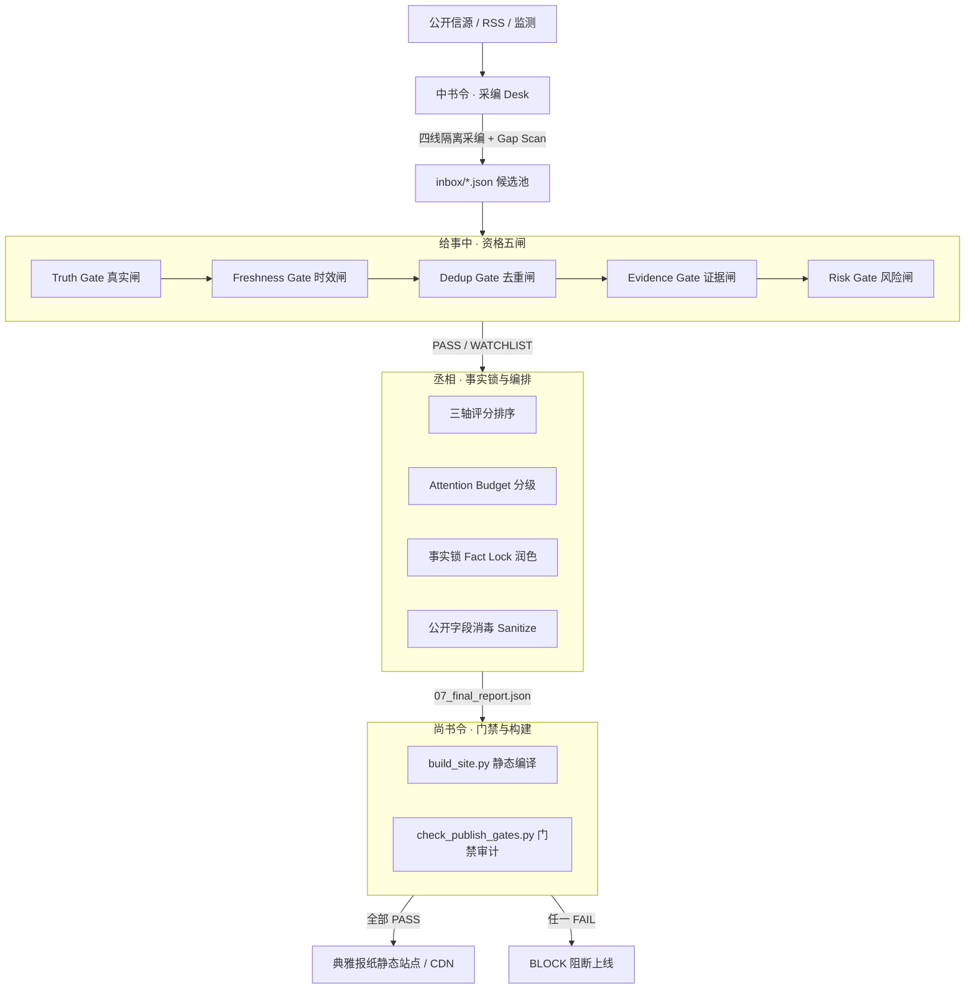

# 长空日报 / Changkong Daily Newsroom

> **面向生产环境的多 Agent 严肃新闻采编操作系统与工程规范**  
> *The Multi-Agent Newsroom Operating System & Journalism Engineering Spec*

[](https://www.python.org/)
[](LICENSE)
[](SKILL.md)
[](SKILL.md)

[English Documentation](README_EN.md) | [中文说明](README.md) | [Agent Skill 规范](SKILL.md)

---

## 为什么需要长空日报？

市面上 99% 的“AI 早报”本质都是简易玩具：**拉取 RSS $\to$ 送给单个大 Prompt 总结 $\to$ 拼装 HTML/Markdown 输出**。

在实际生产场景中，这种单 Agent / 单 Prompt 机制必然引发严重质量崩溃：
1. **厂商公关吹水当客观事实**：模型轻信厂商自测软文，直接当成技术突破发头条；
2. **旧闻翻炒冒充突发**：社交平台热搜翻红的几个月前旧闻，被当作全新事件；
3. **严重幻觉与数字张冠李戴**：缺少原子事实拆解，融合成文时乱编因果；
4. **凑数强迫症**：设定了“每栏必须满 8 条”，导致低价值垃圾信息大量填充；
5. **既当运动员又当裁判**：同一个 Agent 既负责找新闻又负责打分，Prompt 越调越偏。

**长空日报（Changkong Daily Newsroom）** 跳出了“Prompt 调优”思维，将**美联社/路透级新闻核验规范**与**编译器级 CI/CD 门禁**深度融合，构建了一套确定性、分工严密的多 Agent 采编流水线。

---

## 核心架构：四人制内阁

系统将新闻采编全生命周期严格解耦，由四个角色各司其职，**上下文物理隔离**：



### 角色权限边界（HARD RULES）

| 角色 | 职能定位 | 核心动作 | 严格禁止 |
| :--- | :--- | :--- | :--- |
| **中书令** | 采编 Desk | 四线独立采编（中国/国际/财经/科技），Gap Scan 查漏 | 严禁自行定稿、审判或过滤重大候选 |
| **给事中** | 核验 Gate | 严格执行**五资格闸**，决定事件“能不能报道” | 严禁因主观喜好永久淘汰已核验重要事件 |
| **丞相** | 定稿 Desk | 跨栏竞争、精力预算、全站头条决策、**事实锁润色** | **严禁自行发明新事实/因果**；严禁私自构建部署 |
| **尚书令** | 刊印 Publish | 运行模板引擎、机器门禁审计（配额/防泄漏/时效） | 严禁修改稿件事实；门禁失败绝不发布 |

---

## 六大工程原则

1. **原子声明核验（Atomic Claims）**：每条候选新闻拆解为最小颗粒度 Claim，区分官方决定、合约条款与 `VENDOR_CLAIM_ONLY`（厂商单方宣称）。
2. **事实锁（Fact Lock）**：丞相在定稿和润色时，只允许重构句式和语序，**绝不允许添加任何未在 Claims 中出现的数字、事实或因果推论**。
3. **三轴独立评分（Three-Axis Rubric）**：
   - `news_importance`（公共新闻价值 0~100）
   - `evidence_confidence`（证据链确定度 0~100）
   - `interest_relevance`（个人/垂类兴趣度，**严禁用来挽救低价值水文**）
4. **高价值待核实池（Watchlist）**：高重要度（$\ge 65$）但证据不足（$< 60$）的重大爆料/传闻，不强发头条，亦不草率丢弃，而是降级收录至《提前关注/待确认》。
5. **宁缺毋滥（Zero Minimum Quota）**：定稿仅设版面上限（中国 8、国际 8、财经 6、科技 8），**无最低刊登条数**。今日无大事则留白，严禁凑数。
6. **公开字段消毒（Sanitize & Canonical Hash）**：所有内部打分、给事中审核指令、思考链路在输出前完全剥离，杜绝内部编辑痕迹泄漏；对公开内容计算 Canonical Hash，确保发布幂等。

---

## 极速体验（1 分钟上手）

本项目已配备最小可运行环境（Minimal Viable Runtime - MVR）与仿真样本：

### 1. 安装依赖

环境要求：Python 3.8+

```bash
git clone https://github.com/rowanjove/changkong-daily-newsroom.git
cd changkong-daily-newsroom
pip install -r requirements.txt
```

### 2. 一键运行内阁演示流水线

```bash
python run_demo.py
```

### 3. 查看输出

流水线将在几秒钟内完成：
- **给事中核验**：审查包含正反例的候选池，展示厂商自吹公关稿如何被拦截、旧闻翻炒如何被退回、重大传闻如何进入 Watchlist；
- **丞相定稿**：产出全站头条与栏目分级，严格执行事实锁与公开字段消毒；
- **尚书令刊印**：基于典雅纯正的传统报纸版式生成 `dist/index.html`；
- **发布门禁**：执行配额与反泄漏检查，全部绿灯通过！

直接用浏览器打开 `dist/index.html` 即可预览高质感排版报纸。

---

## 目录结构

```text
changkong-daily-newsroom/
├── README.md               # 项目主文档
├── README_EN.md            # 英文文档
├── SKILL.md                # 标准 Agent Skill 规范（Cursor / Grok Bot 载入点）
├── LICENSE                 # MIT 开源协议
├── requirements.txt        # 依赖项（PyYAML, Jinja2）
├── run_demo.py             # 一键运行全套流水线与门禁
│
├── config/
│   ├── policy.yaml         # 机器权威配置（单一事实源：阈值/配额/权重）
│   └── policy.example.yaml # 配置模板
│
├── templates/
│   └── daily_template.html # 纯正报纸质感 Jinja2 模板（响应式/带折叠分析）
│
├── fixtures/
│   └── mock_inbox.json     # 仿真候选池（含官方通告、旧闻炒冷饭、厂商吹水等典型Case）
│
├── scripts/
│   ├── build_site.py       # 尚书令：静态网页渲染
│   └── pipeline/
│       ├── gates.py        # 给事中：资格五闸逻辑
│       ├── editorial.py    # 丞相：事实锁、三轴评分、Attention Budget
│       ├── policy_loader.py# 单一源 Policy 加载器
│       └── pipeline_runner.py # 流水线串联核心
│
├── audits/
│   └── check_publish_gates.py # 尚书令：发布前门禁审计（配额/时效/防泄漏）
│
└── references/             # 20+ 篇深度新闻工程学规约文档
    ├── 01-product-and-roles.md
    ├── 04-sourcing-and-source-levels.md
    ├── 05-gates-five.md
    ├── 06-scoring-and-importance-rubric.md
    ├── 06b-evidence-rubric.md
    ├── 08-editorial-desk.md
    ├── 09-fact-lock-and-finalize.md
    └── 17-rule-layers-hard-soft.md
```

---

## 作为 Agent Skill 导入

如果你正在使用 **Cursor**、**Grok Bot** 或 **Antigravity**：
1. 将本项目目录复制或链接到你的技能目录（如 `~/.cursor/skills/` 或工作区 skills 目录）；
2. Agent 将直接解析 [`SKILL.md`](SKILL.md) 与 [`references/`](references/)，自动具备内阁采编、五资格闸审查和事实锁写作能力。

---

## 开源协议

本项目基于 [MIT License](LICENSE) 开源。欢迎 Star、Fork 并用于构建你自己的高品质多 Agent 新闻室！
