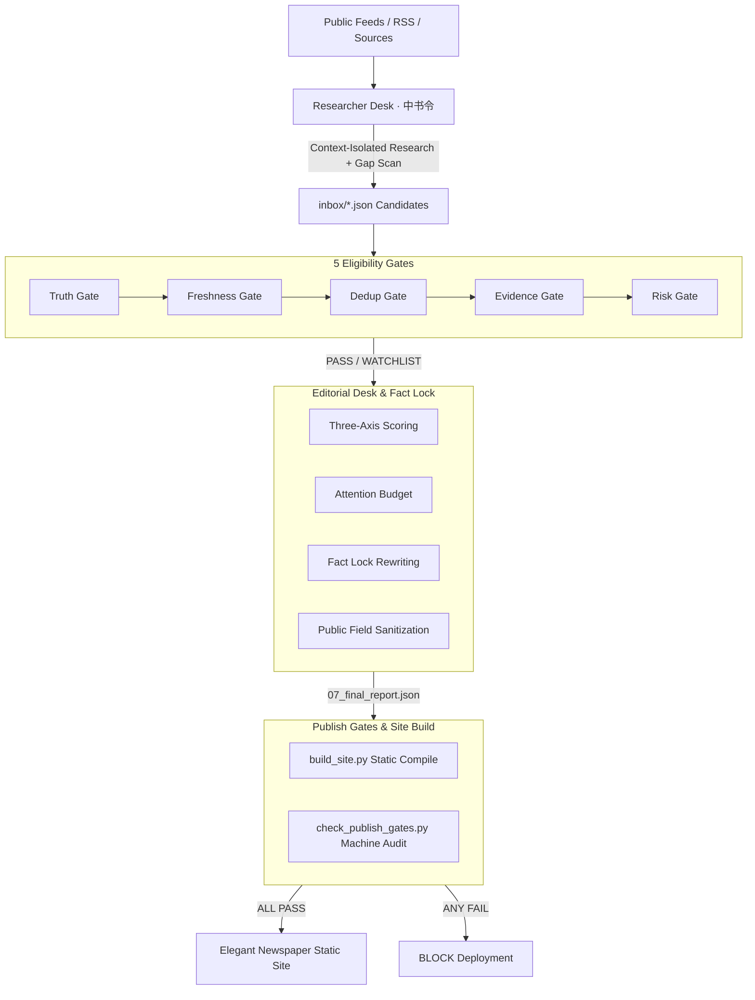

# Changkong Daily Newsroom

> **A Production-Grade Multi-Agent Newsroom Operating System & Journalism Engineering Spec**

[](https://www.python.org/)
[](LICENSE)
[](SKILL.md)
[](SKILL.md)

[English Documentation](README_EN.md) | [中文说明](README.md) | [Agent Skill Spec](SKILL.md)

---

## Why Changkong Daily Newsroom?

Most "AI Daily Digest" projects today are toy scripts: **Fetch RSS $\to$ Prompt an LLM to summarize $\to$ Output Markdown/HTML**.

In real-world production, this single-agent / single-prompt architecture reliably falls apart:
1. **PR Hype Treated as Objective Truth**: Models fall for uncorroborated vendor claims and benchmark bragging.
2. **Old News Recycled as Breaking**: Viral social media reposts of months-old guidelines get framed as new updates.
3. **Severe Hallucinations & Fabricated Correlations**: Without atomic claim decomposition, models invent causal links during rewriting.
4. **Quota Padding (Filler Junk)**: Hard requirements like "must have 10 stories" force the AI to include low-value filler.
5. **No Separation of Concerns**: The same agent both discovers stories and scores their importance, leading to unconstrained prompt drift.

**Changkong Daily Newsroom** shifts the paradigm from simple prompt tweaking to **rigorous journalism engineering combined with compiler-grade CI/CD publish gates**.

---

## Architecture: The 4-Role Separation of Concerns

The pipeline enforces physical context isolation across 4 distinct roles:



### Role Permissions & Boundaries (HARD RULES)

| Role | Responsibility | Core Actions | Strict Restrictions |
| :--- | :--- | :--- | :--- |
| **Researcher** (*中书令*) | Discovery Desk | Isolated multi-desk gathering + Coverage Gap Scan | Forbidden from finalizing, judging, or discarding high-importance items |
| **Fact-Checker** (*给事中*) | Eligibility Gate | Evaluates **5 Eligibility Gates**; decides *if* a story is reportable | Forbidden from permanently dropping stories solely based on subjective preference |
| **Chief Editor** (*丞相*) | Editorial Desk | Decides daily lead story, story budget, **Fact-Lock rewriting** | **Strictly forbidden from inventing new facts/numbers**; cannot build/deploy |
| **Publisher** (*尚书令*) | Publishing Engine | Static HTML rendering and automated **Publish Gates** auditing | Strictly forbidden from altering copy; deployment strictly blocked on gate failure |

---

## Core Engineering Principles

1. **Atomic Claim Verification**: Every candidate event is broken down into atomic claims, distinguishing official decisions, contracts, and `VENDOR_CLAIM_ONLY`.
2. **Fact Lock**: The Chief Editor may polish tone, structure, and headlines, but is **strictly forbidden from introducing any fact, statistic, or attribution not present in the verified claims**.
3. **Three-Axis Independent Scoring**:
   - `news_importance` (Public news value: 0–100)
   - `evidence_confidence` (Evidence certainty: 0–100)
   - `interest_relevance` (Secondary preference: *forbidden from saving low-value filler*)
4. **Watchlist for High Importance + Low Evidence**: Breaking rumors with massive implications ($\ge 65$ importance) but unverified sources ($< 60$ evidence) are placed in a special *Watchlist / Pending Verification* section rather than forced into the lead story.
5. **Zero Minimum Quota**: Upper bounds only (China: 8, World: 8, Finance: 6, Tech: 8). If today is a quiet news day, sections remain clean. **No padding.**
6. **Public Sanitization & Canonical Hash**: Internal audit trails, editor instructions, and agent reasoning chains are completely scrubbed before public rendering.

---

## Quick Start (1-Minute Demo)

This repository includes a **Minimal Viable Runtime (MVR)** with realistic fixtures:

### 1. Install Dependencies

Requires Python 3.8+

```bash
git clone https://github.com/rowanjove/changkong-daily-newsroom.git
cd changkong-daily-newsroom
pip install -r requirements.txt
```

### 2. Run the Full Cabinet Pipeline Demo

```bash
python run_demo.py
```

### 3. Review the Output

Within seconds, the pipeline will execute:
- **Fact-Checker Audit**: Rejects vendor hype, blocks stale recycled news, and downgrades unverified megamerger rumors to the Watchlist.
- **Editorial Finalization**: Selects the Lead Story, applies the Fact-Lock, and scrubs internal metadata.
- **Publisher Build**: Compiles a responsive, classic newspaper static HTML to `dist/index.html`.
- **Publish Gates Audit**: Runs machine quota and anti-leakage checks (All Pass).

Open `dist/index.html` in your web browser to view the generated newspaper edition.

---

## Project Structure

```text
changkong-daily-newsroom/
├── README.md               # Chinese documentation
├── README_EN.md            # English documentation
├── SKILL.md                # Agent Skill definition (Cursor / Grok Bot entry)
├── LICENSE                 # MIT License
├── requirements.txt        # Minimal dependencies (PyYAML, Jinja2)
├── run_demo.py             # One-click demo script
│
├── config/
│   ├── policy.yaml         # Single Source of Truth (thresholds, quotas, weights)
│   └── policy.example.yaml
│
├── templates/
│   └── daily_template.html # Responsive newspaper Jinja2 template
│
├── fixtures/
│   └── mock_inbox.json     # Multi-scenario fixtures (vendor fluff, stale news, breaking leads)
│
├── scripts/
│   ├── build_site.py       # Publisher: Static HTML renderer
│   └── pipeline/
│       ├── gates.py        # Fact-Checker: 5 Eligibility Gates
│       ├── editorial.py    # Chief Editor: Fact lock, Attention budget
│       ├── policy_loader.py# Single-source policy loader
│       └── pipeline_runner.py # Core pipeline orchestrator
│
├── audits/
│   └── check_publish_gates.py # Publisher: Machine publish gate audit
│
└── references/             # 20+ In-depth journalism engineering specs
```

---

## Import as an Agent Skill

If you use **Cursor**, **Grok Bot**, or **Antigravity**:
1. Copy or symlink this folder into your skills directory (e.g., `~/.cursor/skills/`);
2. The agent will parse [`SKILL.md`](SKILL.md) and [`references/`](references/) to adopt cabinet workflows, 5-gate fact-checking, and Fact-Lock rules out of the box.

---

## License

This project is open-sourced under the [MIT License](LICENSE).
